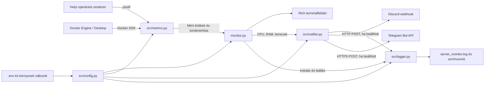
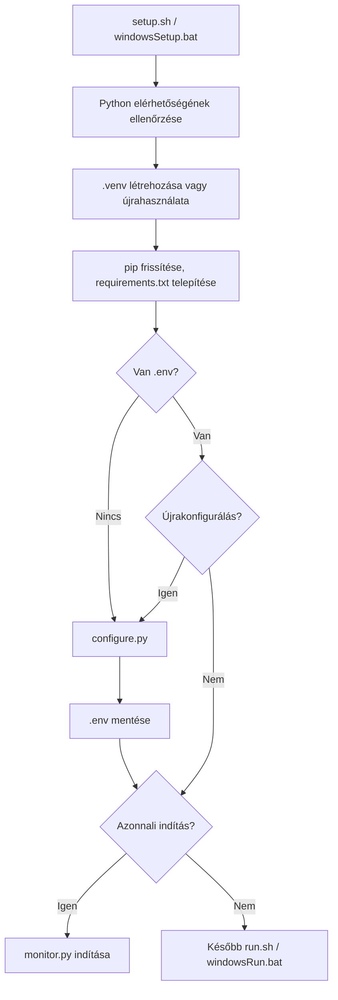
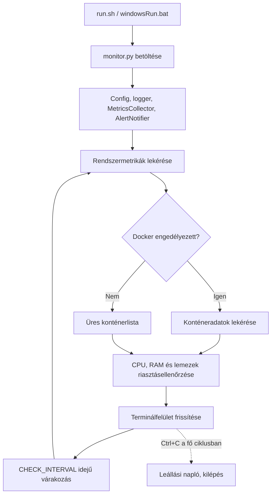
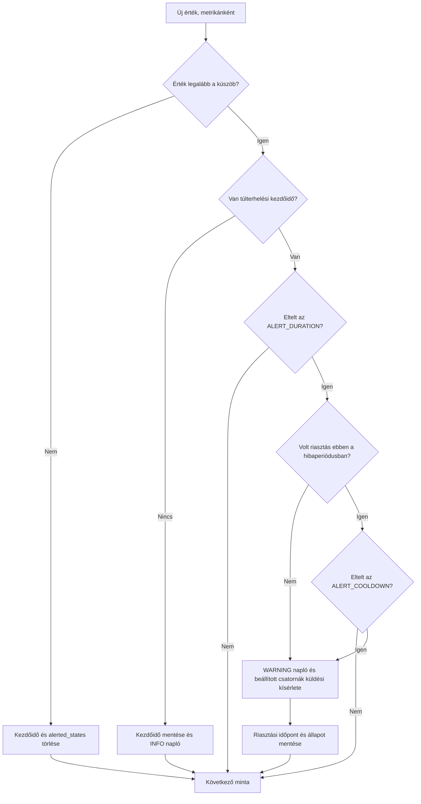

# Server Monitoring – teljes dokumentáció

A Server Monitoring Python-alapú szerverfigyelő alkalmazás. Ez a dokumentáció bemutatja a felépítését, függőségeit, telepítését, konfigurációját és működését. Az ábrák Mermaid formátumúak; megjelenítésükhöz Mermaid-támogatású Markdown-nézet használható, például a GitHub fájlnézete.

## Tartalom

1. [Rendeltetés](#1-rendeltetés)
2. [Rendszerkövetelmények és függőségek](#2-rendszerkövetelmények-és-függőségek)
3. [Fájlok és felelősségek](#3-fájlok-és-felelősségek)
4. [Topológia és adatáramlás](#4-topológia-és-adatáramlás)
5. [Telepítés és indítás](#5-telepítés-és-indítás)
6. [Konfiguráció](#6-konfiguráció)
7. [Adatgyűjtés és megjelenítés](#7-adatgyűjtés-és-megjelenítés)
8. [Riasztások](#8-riasztások)
9. [Naplózás és tárolás](#9-naplózás-és-tárolás)
10. [Üzemeltetés](#10-üzemeltetés)
11. [Fejlesztői áttekintés](#11-fejlesztői-áttekintés)

## 1. Rendeltetés

A program egy helyi gép erőforrásait figyeli, teljes képernyős terminálfelületen jeleníti meg az eredményeket, és tartós CPU-, RAM- vagy lemezterhelés esetén riasztást készít. Az értesítések opcionálisan Discordra és Telegramra küldhetők.

| Funkció | Megjelenítés | Küszöbértékes riasztás |
| --- | --- | --- |
| Összesített CPU-használat | Igen | Igen |
| RAM-használat | Igen | Igen |
| Partíciók telítettsége | Igen | Igen, partíciónként |
| Összesített hálózati sebesség | Igen | Nincs |
| Docker-konténerek állapota és healthcheckje | Igen, opcionálisan | Nincs |

Az alkalmazás a Python-folyamatot futtató gép rendszeradatait gyűjti. Működésének három fő része az erőforrások mérése, az aktuális állapot megjelenítése és a tartós küszöbérték-túllépések jelzése.

## 2. Rendszerkövetelmények és függőségek

### Futtatási környezet

- Python **3.10+** futtatókörnyezet szükséges.
- Célplatformok: Linux, macOS és Windows.
- Python `venv` és `pip` szükséges a telepítőkhöz. Unix rendszereken Bash, Windowson a `.bat` fájlokhoz parancsértelmező szükséges.
- Írási jog szükséges a projektkönyvtárhoz a virtuális környezet, a konfiguráció és a napló létrehozásához.
- A csomagok letöltéséhez hálózat szükséges. Futás közben külső hálózati kapcsolatot az engedélyezett értesítési csatornák igényelnek.
- A Docker-funkcióhoz elérhető Docker Engine vagy Docker Desktop és a Docker API használatára jogosult felhasználó szükséges.

### Közvetlen Python-függőségek

Az alábbi táblázat a `requirements.txt` fájlban meghatározott minimális csomagverziókat és azok szerepét mutatja.

| Csomag | Deklarált verzió | Szerep | Használó modul |
| --- | --- | --- | --- |
| `psutil` | `>=5.9.0` | CPU, memória, partíciók, lemezfoglaltság, hálózati számlálók | `src/metrics.py`, `configure.py` |
| `rich` | `>=13.0.0` | Élő terminálfelület, táblázatok, panelek, interaktív kérdések | `monitor.py`, `configure.py` |
| `httpx` | `>=0.27.0` | Szinkron HTTP POST kérések az értesítésekhez | `src/notifier.py` |
| `python-dotenv` | `>=1.0.0` | `.env` betöltése környezeti változókká | `src/config.py` |
| `docker` | `>=7.0.0` | Python Docker SDK, kapcsolat és konténeradatok | `src/metrics.py` |

A telepítő a `requirements.txt` valamennyi csomagját telepíti. A Docker-monitorozás használatát az `ENABLE_DOCKER` beállítás szabályozza.

A standard könyvtári `os`, `sys`, `time`, `socket`, `pathlib`, `typing` és `logging` modulokat nem kell külön telepíteni.

A közvetett függőségeket a pip oldja fel a megadott verziófeltételek alapján. A telepített csomagok listája és függőségeik ellenőrzése Unix alatt:

```bash
./.venv/bin/python -m pip list
./.venv/bin/python -m pip check
```

Windows PowerShellben:

```powershell
.\.venv\Scripts\python.exe -m pip list
.\.venv\Scripts\python.exe -m pip check
```

## 3. Fájlok és felelősségek

| Fájl | Feladat |
| --- | --- |
| `monitor.py` | Belépési pont, inicializálás, mérési ciklus, Rich felület, riasztásellenőrzések meghívása |
| `src/config.py` | Projektgyökér meghatározása, `.env` betöltése, `Config` osztály |
| `src/metrics.py` | `MetricsCollector`: rendszer- és Docker-adatok összegyűjtése |
| `src/notifier.py` | `AlertNotifier`: időzítők, küszöbök, üzenetformázás és küldés |
| `src/logger.py` | Közös `server_monitor` logger és forgó fájlkezelő |
| `src/__init__.py` | Python-csomagjelölő |
| `configure.py` | Küszöbök, partíciók, Docker és értesítések interaktív beállítása |
| `.env.example` | Másolható konfigurációs sablon |
| `.env` | Helyi beállítások és opcionális értesítési hitelesítő adatok |
| `requirements.txt` | Közvetlen Python-függőségek |
| `setup.sh`, `windowsSetup.bat` | Környezet telepítése, konfigurálás és opcionális azonnali indítás |
| `run.sh`, `windowsRun.bat` | A monitor indítása a virtuális környezetből |
| `.gitignore` | Többek között a `.venv`, `.env`, Python-cache, `.DS_Store`, valamint az aktív és archivált szervernaplók kizárása |
| `README.md` | Rövid projektismertető és gyorsindítás |

## 4. Topológia és adatáramlás

### Komponensek és külső kapcsolatok



A monitor Docker-kliense a `docker.from_env()` beállításait használja. Ha a környezet távoli Docker-végpontra mutat, a konténerlista arról érkezhet, miközben a CPU-, RAM-, lemez- és hálózati adatok továbbra is a Python-folyamat helyi környezetéből származnak.

### Telepítési útvonal



A telepítési folyamat a Python-környezet előkészítését, a függőségek telepítését és a konfiguráció létrehozását foglalja össze.

### Futási ciklus



A lépések sorban futnak. Egy mérési ciklus idejét az adatgyűjtés, az értesítésküldés, a megjelenítés és a `CHECK_INTERVAL` által meghatározott várakozás együtt adja.

## 5. Telepítés és indítás

A parancsokat a projekt gyökérkönyvtárából futtasd.

### Linux és macOS

```bash
python3 --version
chmod +x setup.sh run.sh
./setup.sh
```

A telepítő létrehozza a `.venv` környezetet, telepíti a csomagokat, majd szükség esetén megnyitja a konfigurátort. A végén felajánlja az indítást. Később:

```bash
./run.sh
```

Az első telepítés belépési pontja a `setup.sh`, a későbbi indításoké a `run.sh`. Az indító a projekt `.venv` környezetében futtatja a monitort.

### Windows

PowerShellből:

```powershell
python --version
.\windowsSetup.bat
```

Későbbi indítás:

```powershell
.\windowsRun.bat
```

A Windows-indító a projekt virtuális környezetét aktiválja, majd futtatja a `monitor.py` fájlt. A virtuális környezet előkészítéséhez a `windowsSetup.bat` telepítőt használja.

### Kézi telepítés, varázsló nélkül

Unix:

```bash
python3 -m venv .venv
./.venv/bin/python -m pip install -r requirements.txt
# Csak ha még nincs saját .env fájlod:
cp .env.example .env
# Szerkeszd a .env fájlt, majd:
./.venv/bin/python monitor.py
```

Windows PowerShell:

```powershell
python -m venv .venv
.\.venv\Scripts\python.exe -m pip install -r requirements.txt
# Csak ha még nincs saját .env fájlod:
Copy-Item .env.example .env
# Szerkeszd a .env fájlt, majd:
.\.venv\Scripts\python.exe monitor.py
```

Leállítás: **Ctrl+C**. A fő ciklus ezt naplózza és 0-s kilépési kóddal zárul.

## 6. Konfiguráció

A `src/config.py` a projektgyökérben lévő `.env` fájlt tölti be. A már meglévő folyamat-környezeti változók elsőbbséget élveznek. Az értékek a modul betöltésekor állnak be; módosítás után indítsd újra a monitort.

| Változó | Kódbeli alapérték | Jelentés |
| --- | --- | --- |
| `CPU_THRESHOLD` | `85.0` | CPU-riasztási küszöb, százalék |
| `RAM_THRESHOLD` | `90.0` | RAM-riasztási küszöb, százalék |
| `DISK_THRESHOLD` | `90.0` | Minden figyelt lemez közös küszöbe, százalék |
| `CHECK_INTERVAL` | `3` | Ciklusvégi várakozás, egész másodperc |
| `ALERT_DURATION` | `30` | Tartós túlterhelés szükséges ideje, egész másodperc |
| `ALERT_COOLDOWN` | `300` | Azonos hibaperióduson belüli ismétlés időköze, egész másodperc |
| `MONITORED_DISKS` | Üres | Vesszővel elválasztott csatolási pontok vagy eszköznevek; üresen automatikus felderítés |
| `ENABLE_DOCKER` | `false` | Bekapcsoló értékek: `true`, `1`, `yes`, kis- és nagybetűtől függetlenül |
| `DISCORD_WEBHOOK_URL` | Üres | Discord webhook címe; üresen nincs Discord-küldés |
| `TELEGRAM_BOT_TOKEN` | Üres | Telegram bot tokenje |
| `TELEGRAM_CHAT_ID` | Üres | Célbeszélgetés azonosítója; Telegramhoz a token és az ID egyaránt szükséges |

A `.env.example` sablonban a Docker-monitorozás engedélyezett (`true`), és a konfigurátor alapválasza is a bekapcsolás. Ha az `ENABLE_DOCKER` változó nincs megadva, a `Config` osztály `false` értéket használ.

Minimális, külső értesítések nélküli példa:

```dotenv
CPU_THRESHOLD=85.0
RAM_THRESHOLD=90.0
DISK_THRESHOLD=90.0
CHECK_INTERVAL=3
ALERT_DURATION=30
ALERT_COOLDOWN=300
MONITORED_DISKS=
ENABLE_DOCKER=false
DISCORD_WEBHOOK_URL=
TELEGRAM_BOT_TOKEN=
TELEGRAM_CHAT_ID=
```

Partíciópéldák, a tényleges géphez igazítva:

```dotenv
# Linux: gyökér és külön adattároló
MONITORED_DISKS=/,/mnt/storage
```

```dotenv
# Windows: a normalizálás miatt a meghajtó betűjele is használható
MONITORED_DISKS=C:,D:
```

### A konfigurátor viselkedése

A `configure.py` bekéri a CPU-, RAM- és lemezküszöböt, megjeleníti a talált partíciókat, majd rákérdez a Dockerre és külön-külön az értesítési csatornákra. A mentett időzítések alapértéke `3`, `30` és `300` másodperc; ezek a `.env` fájlban szerkeszthetők.

Az `all` választás az éppen felderített partíciók konkrét listáját menti. Az üres `MONITORED_DISKS` érték futás közbeni automatikus partíciófelderítést választ.

A konfigurátor az alapértékekből és a megadott válaszokból új `.env` fájlt ír az aktuális munkakönyvtárba, felülírva az ott lévő korábbi konfigurációt. Közvetlen indítása a projektgyökérből:

```bash
./.venv/bin/python configure.py
```

```powershell
.\.venv\Scripts\python.exe configure.py
```

A százalékos küszöbök 0–100 közötti számok, tizedes értéknél ponttal írva, például `85.5`. A `CHECK_INTERVAL` pozitív egész szám, az `ALERT_DURATION` és az `ALERT_COOLDOWN` nem negatív egész szám, másodpercben megadva.

## 7. Adatgyűjtés és megjelenítés

### CPU és memória

A CPU összesített terhelését a `psutil.cpu_percent(interval=None)` adja, a RAM adatai a `psutil.virtual_memory()` eredményéből érkeznek. A memória használt és teljes mérete `1024³` bájtos egységekben (GiB) számolódik. A felület ezeket a `GB` feliratú mezőkben jeleníti meg.

### Lemezek

A felderítés alapja a `psutil.disk_partitions(all=False)`. A program:

1. Kihagyja a `squashfs`, `tmpfs`, `devtmpfs`, `overlay`, `iso9660`, `nullfs`, `autofs`, `proc`, `sysfs`, `devpts` fájlrendszereket.
2. Kihagyja a `/System/Volumes/Update` vagy `/System/Volumes/VM` szöveget tartalmazó csatolási pontokat.
3. Automatikus módban kihagyja a `/boot`, `/boot/efi` és `/boot/` alatti köteteket.
4. Ha van `MONITORED_DISKS`, csatolási pont vagy eszköznév alapján szűr. Az összehasonlítás kisbetűsítve, a záró perjelek eltávolításával történik.
5. Csatolási pont alapján kiszűri az ismétlődéseket, és kihagyja a nulla méretű köteteket.

A boot-kötetek a `MONITORED_DISKS` listában explicit kiválaszthatók; a fájlrendszer- és macOS-szűrések minden esetben érvényesek. Automatikus módban a program a `/` lemezhasználatát is megpróbálja lekérni, ha a partíciófelderítés üres eredményt ad. Explicit lista esetén a kiválasztott köteteket jeleníti meg.

A lemezmérés a kötetek telítettségét, használt és teljes kapacitását mutatja. A kapacitásértékek `1024³` bájtos egységekben számolódnak, a felületen `GB` felirattal.

### Hálózat

A program a `psutil.net_io_counters()` összesített bájtszámlálóinak különbségét osztja az eltelt idővel:

```text
bájt/másodperc = (aktuális számláló − előző számláló) / eltelt másodperc
kijelzett érték = bájt/másodperc × 8 / 1024²
```

A hálózati sor a két mérés között számított összesített fel- és letöltési sebességet mutatja. A számítás bináris Mibit/s egységet használ; a felületen `Mb/s` felirat szerepel. A sor állandó státuszfelirata `AKTÍV`.

### Docker

Inicializáláskor a gyűjtő megpróbál kapcsolódni, és `ping()` hívással ellenőrzi a kapcsolatot. Minden ciklusban `containers.list(all=True)` történik, így a leállított konténerek is szerepelnek.

A megjelenített adatok: konténernév, állapot, healthcheck státusz és az első image-tag. Tag hiányában `unknown`, healthcheck hiányában `-` jelenik meg. A healthcheck-adatok a Docker által előállított állapotból származnak.

### Felület és állapotjelzések

| Feltétel | Jelzés |
| --- | --- |
| Érték kisebb, mint a küszöb 80%-a | Zöld `OK` |
| Érték legalább a küszöb 80%-a, de még a küszöb alatt van | Sárga `FIGYELEM` |
| Érték eléri vagy meghaladja a küszöböt | Piros `KRITIKUS` |

85%-os CPU-küszöbnél a sárga jelzés 68%-tól, a piros 85%-tól látható. A szín azonnal változik; a külső riasztásra külön időzítés vonatkozik.

A Rich felület másodpercenként két újrarajzolásra van beállítva, a mérési adatok a fő ciklus ütemében frissülnek. A fejléc időbélyege az utolsó felületgenerálás ideje. Docker engedélyezésekor a fő nézet két oszlopra oszlik.

## 8. Riasztások

### Döntési folyamat



Az állapot CPU-ra, RAM-ra és minden lemezre külön él. Az azonosító a metrika kisbetűsített neve, például `cpu` vagy `lemez (/)`.

Alapértékekkel, ideális 3 másodperces mintaközzel:

| Idő az első magas mintától | CPU | Eredmény |
| --- | --- | --- |
| 0 mp | 90% | Időzítő indul |
| 3–27 mp | Minden minta legalább 85% | Még nincs riasztás |
| 30 mp | 90% | Első riasztási kísérlet |
| 330 mp | Továbbra is legalább 85% | Ismételt riasztási kísérlet |
| Következő, 85% alatti minta | 60% | Hibaperiódus lezárása |

A folyamatos túlterhelés értékelése egymást követő minták alapján történik: a riasztási időzítő addig fut, amíg a mért értékek elérik vagy meghaladják a küszöböt.

### Fontos időzítési részletek

- Normál tartományba visszatérő mintánál a túlterhelés kezdőideje és az `alerted_states` bejegyzés törlődik. A következő túlterhelési időszak saját időzítéssel indul.
- Az első magas minta rögzíti a kezdőidőt. A következő magas mintáknál a program ellenőrzi az eltelt időt.
- Az időzítők a folyamat memóriájában élnek, és minden programindításkor inicializálódnak.
- Az ismétlési idő a riasztási folyamat meghívásai között érvényesül, metrikánként.
- Az eltelt idő számításának alapja a `time.time()` által visszaadott időbélyeg.

### Értesítési csatornák

Az üzenet tartalmazza a helyi gép nevét, a metrika nevét, a jelenlegi értéket, a küszöböt, az észlelt fennállás idejét és a helyi időbélyeget.

| Csatorna | Kérés | Sikernek tekintett HTTP-kód |
| --- | --- | --- |
| Discord | A megadott webhook URL-re küldött POST, `content` JSON-mezővel | `200`, `204` |
| Telegram | POST a `https://api.telegram.org/bot<TOKEN>/sendMessage` címre, `chat_id`, `text`, `parse_mode` mezőkkel | `200` |

Mindkét csatorna külön `httpx.Client(timeout=5.0)` klienst használ. A kérések egymás után, a fő mérési ciklusban futnak. Az HTTP-műveletekhez beállított időtúllépés 5 másodperc.

A Telegram-üzenet `Markdown` formázással készül. A program a Discord-üzenet dupla csillagait a Telegram formátumának megfelelő szimpla csillagokra cseréli.

## 9. Naplózás és tárolás

A napló a projektgyökér `server_monitor.log` fájlja. A `RotatingFileHandler` beállítása: `5 × 1024 × 1024` bájt névleges mérethatár és három archívum. Ez nagyjából 20 MiB helyigény az aktív és a három archív fájlra együtt.

```text
server_monitor.log
server_monitor.log.1
server_monitor.log.2
server_monitor.log.3
```

| Szint | Esemény |
| --- | --- |
| `INFO` | Főprogram indulása, Ctrl+C-s leállás, túlterhelési időzítő indulása |
| `WARNING` | Riasztás létrehozása |
| `ERROR` | Kezelt HTTP-hibák és értesítésküldési kivételek |

A riasztási naplóbejegyzés a riasztási folyamat indításakor keletkezik. A napló az indulási, leállási, küszöbátlépési és értesítésküldési eseményeket rögzíti.

A `.env` az értesítési csatornák tokenjeit és webhook címét is tárolhatja, ezért helyi konfigurációként szerepel a `.gitignore` listában. A `server_monitor.log*` szabály az aktív naplót és minden ilyen nevű archív vagy tömörített változatot (például `server_monitor.log.1`, `server_monitor.log.3.gz`) kizár a projekt minden almappájában is. A `.DS_Store` fájlok szintén minden almappában kizártak.

## 10. Üzemeltetés

### Háttérben tartás

A program alapvetően interaktív terminálalkalmazás. Unix alatt egy már telepített `tmux` használatával megtartható a munkamenet:

```bash
tmux new -s monitor
./run.sh
```

Leválás: `Ctrl+B`, majd `D`. Visszatérés:

```bash
tmux attach -t monitor
```

A `tmux` opcionális rendszerprogram, a terminálmunkamenet fenntartására szolgál. A README-ben szereplő Windows VBS-példa a konzolablak elrejtésével indítja az alkalmazást.

### Ellenőrzés telepítés után

1. A megfelelő Python-környezetben futtasd a `pip check` parancsot.
2. Indítsd el a programot, és ellenőrizd a CPU-, RAM- és lemezsorokat.
3. Docker használatakor ellenőrizd, hogy a várt konténerek láthatók-e.
4. Ellenőrizd a `server_monitor.log` indulási bejegyzését.
5. Ha értesítést is tesztelsz, erre kijelölt csatornát használj. A CPU-küszöb ideiglenes `0` értéke riasztást válthat ki terhelésgenerálás nélkül; utána állítsd vissza az értéket és indítsd újra a programot. Ez a teszt tényleges üzeneteket küldhet.

## 11. Fejlesztői áttekintés

### Belső interfészek

| Hívás | Visszatérés / hatás |
| --- | --- |
| `MetricsCollector(enable_docker)` | Docker-kliens és kezdeti hálózati számlálók inicializálása |
| `get_system_metrics()` | Szótár: `cpu_percent`, `ram_percent`, `ram_used_gb`, `ram_total_gb`, `disks`, `net_upload_mbps`, `net_download_mbps` |
| `_get_disks_metrics()` | Lista, elemenként: `device`, `mount`, `fstype`, `percent`, `used_gb`, `total_gb` |
| `get_docker_metrics()` | Lista, elemenként: `name`, `status`, `health`, `image` |
| `generate_layout(metrics, containers)` | Rich `Layout` fejléc-, fő- és láblécrésszel |
| `check_and_alert(metrics)` | CPU, RAM és minden kapott lemez továbbítása a notifiernek |
| `AlertNotifier.check_metric(name, value, threshold)` | Küszöbellenőrzés, állapotkezelés, szükség esetén küldés |
| `setup_logger()` | Közös logger visszaadása; csak meglévő handler hiányában ad új fájlkezelőt |

Az `AlertNotifier` három memóriabeli szótárat használ: a `breach_start_times` a túlterhelések kezdetét, a `last_alert_times` a legutóbbi riasztások időpontját, az `alerted_states` pedig az adott túlterhelési időszak riasztási állapotát tartja nyilván.

A `monitor.py` modul betöltésekor létrejön a naplózó, az adatgyűjtő és a riasztáskezelő. Az adatgyűjtő inicializálása beállítja a hálózati számlálókat, és engedélyezett Docker-monitorozásnál létrehozza a Docker-kapcsolatot. A fő ciklus a program közvetlen indításakor lép életbe.
